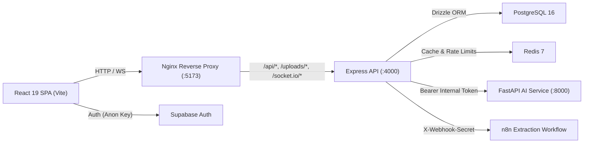

# AI-Powered Student Career & Placement Success Portal

An enterprise, single-institution placement management and career readiness platform. It unifies student profiles and ATS-scored resumes, AI-assisted job/internship ingestion, eligibility-gated applications, timed mock tests, AI mock interviews, career roadmaps, skill-gap analysis, targeted notices/notifications, and institutional analytics across a TypeScript monorepo and Python AI microservice.

---

## Key Capabilities

- **Identity, RBAC & Governance (`STUDENT`, `PLACEMENT_FACULTY`, `ADMIN`)**: Supabase Auth JWTs paired with PostgreSQL RBAC (`roles`, `permissions`, `user_roles`, `role_permissions`), Redis permission caching, Socket.IO session enforcement, and append-only `audit_logs` / `ai_job_logs`.
- **Student Profiles & Resume Intelligence**: Academic profiles (department, program, batch, CGPA), skills matrix, multi-template resume builder/PDF exporter, and FastAPI-powered ATS scoring, text enhancement, and opportunity matching.
- **Opportunities & AI Ingestion Pipeline**: Unified `opportunities` model (jobs + internships), automated eligibility matching (`EligibilityService`), application state-machine tracking, and an n8n + LLM extraction pipeline (`opportunity_sources` → `ai_extraction_runs` → `opportunity_drafts`) with mandatory faculty review before publishing.
- **Preparation & Career Readiness**: Timed section-based mock tests with server-side answer keys and atomic grading, AI-evaluated mock interviews, career paths, personalized roadmaps, learning resources, and skill-gap diagnostics.
- **Engagement & Analytics**: Targeted notices (scheduled/pinned/expiring with poster uploads), real-time Socket.IO + Nodemailer notifications, and role-specific placement/preparation analytics dashboards.

---

## System Architecture



- **Auth vs. Database:** Supabase Auth owns credentials, sessions, and JWTs. Express enforces API authorization and talks to PostgreSQL via Drizzle ORM; PostgreSQL Row-Level Security (`packages/db/rls/`) provides defense-in-depth for Supabase PostgREST.
- **AI Isolation:** The FastAPI AI service (`apps/ai-service`) is internal-only (bound to `127.0.0.1` in Compose, authenticated via `AI_SERVICE_INTERNAL_TOKEN`), and AI-extracted opportunities always land in `opportunity_drafts` for faculty approval before publishing.

---

## Tech Stack

| Layer | Technologies |
|---|---|
| **Frontend (`apps/web`)** | React 19, TypeScript, Vite 7, Tailwind CSS, shadcn/ui, Redux Toolkit, TanStack Query, React Router 7, React Hook Form + Zod v4, Socket.io Client, Recharts, Framer Motion |
| **Backend API (`apps/api`)** | Node.js ≥ 20.19, Express 4, TypeScript, Drizzle ORM, Zod v4, Socket.io, Helmet, Express Rate Limit, Multer, Nodemailer 10, Pino |
| **AI Service (`apps/ai-service`)** | Python 3.12, FastAPI, Pydantic v2, PyMuPDF, BeautifulSoup4, OpenAI / NVIDIA NIM / Groq (`AI_PROVIDER`) |
| **Database & Cache (`packages/db`)** | PostgreSQL 16, Drizzle Kit, Redis 7 (`ioredis`), Supabase Auth & Storage |
| **DevOps & Quality** | Docker & Compose, Nginx, GitHub Actions (`ci.yml` + `security.yml`), ESLint 9, Vitest, Supertest, Playwright, Pytest, Ruff, Mypy |

---

## Repository Structure

```text
apps/
  web/              React SPA, feature modules, Playwright E2E tests (e2e/)
  api/              Express REST + Socket.io API (src/modules/<module>/)
  ai-service/       FastAPI resume intelligence & AI microservice
packages/
  db/               Drizzle schema (50 tables), migrations (drizzle/), RLS SQL (rls/), seeds
  shared-types/     Shared Zod v4 DTOs, API envelope types, URL validation helpers
  config/           Shared ESLint / Prettier / TypeScript configs
infra/
  docker/           Per-service Dockerfiles (api, web, ai-service)
  nginx/            Reverse proxy & CSP/security headers (web.conf)
docs/               Architecture Decision Records, API Contract, n8n Contract & workflow export
scripts/            Smoke checks (production-smoke.cjs) and SLA benchmarks (performance-benchmark.cjs)
.github/workflows/  CI quality/E2E pipeline (ci.yml) & Security Gate (security.yml)
```

---

## Local Development

### Prerequisites

- **Node.js** `>= 20.19.0` and **npm**
- **Python** `>= 3.12`
- **Docker** (for PostgreSQL 16 and Redis 7, or full containerized stack)
- **Supabase Project** (for Auth — PostgreSQL can run locally via Docker in dev)

### 1. Environment Configuration

```bash
cp .env.example .env
```

Configure the required variables in `.env`:

| Group | Variables |
|---|---|
| **Database & Cache** | `DATABASE_URL`, `REDIS_URL` |
| **Supabase Auth** | `SUPABASE_URL`, `SUPABASE_SERVICE_ROLE_KEY`, `SUPABASE_ANON_KEY`, `JWT_SECRET`, `VITE_SUPABASE_URL`, `VITE_SUPABASE_ANON_KEY` |
| **API & CORS** | `API_PORT` (`4000`), `WEB_BASE_URL` (`http://localhost:5173`), `CORS_ALLOWED_ORIGINS` |
| **AI Service** | `AI_SERVICE_BASE_URL` (`http://localhost:8000`), `AI_SERVICE_INTERNAL_TOKEN`, `NVIDIA_API_KEY` / `OPENAI_API_KEY` |
| **n8n Extraction (Optional)** | `N8N_EXTRACTION_WEBHOOK_URL`, `N8N_WEBHOOK_SECRET` (Header Auth `X-Webhook-Secret`) |
| **SMTP (Optional in dev)** | `SMTP_HOST`, `SMTP_PORT`, `SMTP_USER`, `SMTP_PASSWORD`, `EMAIL_FROM` |

### 2. Install, Migrate & Seed

```bash
# Install Node workspace dependencies
npm install

# Start local PostgreSQL & Redis
docker compose up -d postgres redis

# Build shared workspace packages
npm run build -w packages/shared-types && npm run build -w packages/db

# Run Drizzle migrations & seed RBAC roles/permissions
npm run db:migrate
npm run db:seed

# Optional: seed dev faculty/admin accounts (non-production only)
# Set SEED_FACULTY_PASSWORD and SEED_ADMIN_PASSWORD first
npm run db:seed:users
```

> **Applying PostgreSQL RLS (required when deploying to Supabase Postgres):**
> ```bash
> psql "$DATABASE_URL" -f packages/db/rls/001_enable_rls.sql
> psql "$DATABASE_URL" -f packages/db/rls/002_phase6.sql
> psql "$DATABASE_URL" -f packages/db/rls/003_enable_rls_all_tables.sql
> ```

### 3. Python AI Service Setup

```bash
cd apps/ai-service
python -m venv .venv
# Windows: .venv\Scripts\activate | macOS/Linux: source .venv/bin/activate
pip install -r requirements-dev.txt
```

### 4. Run the Development Servers

```bash
npm run dev        # Web (:5173) + API (:4000)
npm run dev:ai     # FastAPI AI Service (:8000)
npm run dev:full   # Web + API + AI Service concurrently
```

| Service | Local URL |
|---|---|
| **Web App** | `http://localhost:5173` |
| **API Health** | `http://localhost:4000/api/v1/health` |
| **API Swagger UI (dev/test only)** | `http://localhost:4000/api/v1/docs` |
| **AI Service Docs (dev only)** | `http://localhost:8000/docs` |

---

## API Contract & Documentation

- **Markdown Specification:** [`docs/API-CONTRACT.md`](./docs/API-CONTRACT.md)
- **OpenAPI JSON & Swagger UI:** Served at `/api/v1/openapi.json` and `/api/v1/docs` in `development` and `test` environments (automatically disabled in `production`).
- **n8n Extraction Workflow:** [`docs/n8n-workflow-export.json`](./docs/n8n-workflow-export.json) and [`docs/N8N-AGENT-CONTRACT.md`](./docs/N8N-AGENT-CONTRACT.md).

---

## Testing & Quality Gates

```bash
# Lint & Typecheck
npm run lint
npx tsc --noEmit -p apps/api/tsconfig.json
npx tsc --noEmit -p apps/web/tsconfig.json

# Unit & Integration Tests
npm test                                                  # API + Web suites
npm run test -w apps/api -- src/test/phase12-api-contract.test.ts
npm run test:e2e                                          # Playwright E2E journeys

# AI Service Checks
cd apps/ai-service && ruff check . && mypy app --ignore-missing-imports && pytest -v

# Production Smoke, Benchmarks & Dependency Audit
npm run build
npm run test:smoke
npm run test:benchmark
npm audit --omit=dev --audit-level=high
```

---

## Security & CI/CD

- **Application Hardening:** Reverse-proxy-aware rate limiting (`trust proxy`), MIME + magic-byte poster validation with sandboxed `/uploads` CSP, DNS-resolving SSRF guard (`ssrf-guard.ts`), `http:`/`https:`-only DTO URL schemas + frontend `safeHref()` sanitization, HTML-escaped email notifications, and deactivated-user revocation across Supabase Auth + Socket.IO.
- **CI Workflows:**
  - [`.github/workflows/ci.yml`](./.github/workflows/ci.yml): Lint, typecheck, migrations, API/Web/AI tests, Playwright E2E, SLA benchmarks, and Docker image builds.
  - [`.github/workflows/security.yml`](./.github/workflows/security.yml): Production `npm audit --audit-level=high`, Python `pip-audit`, and optional diff-scoped Strix PR scanning (`ENABLE_STRIX_CI=true` with `STRIX_LLM` / `LLM_API_KEY`).

---

## Containerized Stack (Docker Compose)

```bash
docker compose up --build
```

- Nginx serves the production SPA and reverse-proxies `/api/`, `/uploads/`, and `/socket.io/` on `http://localhost:5173` with `Content-Security-Policy`, `X-Frame-Options`, `X-Content-Type-Options`, and `Referrer-Policy` headers.
- `postgres` (`5432`), `redis` (`6379`), `api` (`4000`), and `ai-service` (`8000`) bind to `127.0.0.1` so internal services are not exposed on `0.0.0.0`.
- To point the containerized API to an external PostgreSQL instance, set `DOCKER_DATABASE_URL` in `.env`.

---

## Documentation Index

- [`docs/ARCHITECTURE.md`](./docs/ARCHITECTURE.md) — Architectural Decision Records and bounded contexts
- [`docs/API-CONTRACT.md`](./docs/API-CONTRACT.md) — Canonical REST endpoints and response envelopes
- [`docs/N8N-AGENT-CONTRACT.md`](./docs/N8N-AGENT-CONTRACT.md) — AI extraction webhook payload and output schema
- [`docs/PHASE-8-STATUS.md`](./docs/PHASE-8-STATUS.md) — Phase 8 admin, audit, and security status
